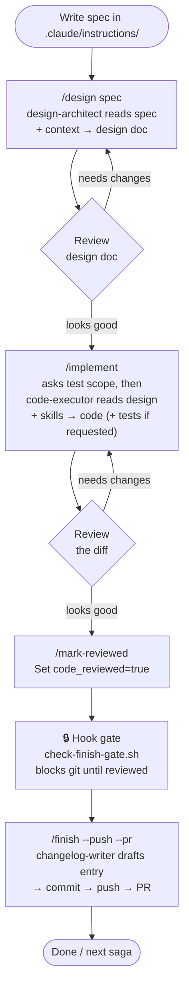

# saga

saga is a Claude Code plugin. It runs a development workflow with gates, from first rune to finished saga:

1. Bootstrap the codebase context.
2. AI design. A human reviews the design, but the plugin does not enforce this review.
3. AI implementation.
4. Code review. A human gate controls this step.
5. Changelog, commit, and pull request.

The plugin targets a Java 25, Spring Boot 4, and PostgreSQL stack. The workflow skeleton (commands, agents, and hooks) does not depend on the stack. Only the five skills under `skills/` are specific to the stack.

## About this plugin

Claude wrote 100% of this plugin. Claude wrote every command, agent, hook, and skill file. But the work was not unsupervised. The author supplied the workflow, the gates, and the conventions in each skill. These come from the author's experience with this type of system. They also come from research into how skills and subagents behave in practice. A human steers. The AI types.

<b>The AI is not liable for what it produces, and this plugin is not liable either</b>. Code from an LLM is a draft. This includes code that this workflow generates. Before the code ships, a human who understands it must review it, test it, and take responsibility for it. The plugin enforces the `/mark-reviewed` gate mechanically. The gate cannot verify that the review was thorough. That part is your responsibility.

> "Pushing broken, untested garbage to PR is laziness dressed up as work.
> Your reviewers are engineers, not babysitters — their time is worth more
> than cleaning up your mess. If your PR gets rejected for something a
> five-minute test would have caught, that's not a process failure. That's a
> you failure. Own it, or find a different profession."
>
> — a fictional developer, in the spirit of Linus Torvalds

## Skills

| Skill | Covers |
|---|---|
| `spring-boot-patterns` | General code rules, package-by-feature layering, validation, conditional wiring, transaction boundaries, error-code `ProblemDetail` handling, contract-first REST clients, API versioning, JSpecify null-safety, security, logging, Javadoc content rules |
| `spring-data-jpa` | Entity mapping, repository design, fetching strategy, projections, pagination, N+1. More detail is in `references/entities.md`, `references/queries.md`, and `references/performance.md` |
| `jooq-conventions` | Codegen, DSL usage, query structure, record-to-DTO mapping |
| `postgres-migrations` | Migration naming, schema organisation, indexing, backward compatibility |
| `testcontainers-testing` | Integration-first testing with no mocks (WireMock, `@ServiceConnection`), given-when-then naming and structure, reproducible fixtures, query-count assertions |

`spring-data-jpa` and `jooq-conventions` are **mutually exclusive**. A project uses one of them as its primary data-access layer. `/init-context` step 0b selects the layer as follows:

- For an existing project, it reads the build file to find the layer.
- For a new project, it asks you.

It records the answer under `## Persistence stack` in `.claude/context/PATTERNS.md`. Then it writes only the conventions override that matches. The code-executor reads that heading to decide which of the two skills to load. Do not leave the heading blank.

Each skill ends with a `## Review checklist`. The checklist lists the violations that a reviewer must flag. Each violation has a default severity (High, Medium, or Low). An item marked `[guardrail]` can have a test (ArchUnit or a linter) that enforces it instead of a reviewer.

## Writing rules

All documents that saga writes follow [`templates/writing-rules.md`](templates/writing-rules.md). These include design docs, implementation notes, review reports, context docs, and changelog entries. The rules are a short set adapted from ASD-STE100 Simplified Technical English. They keep sentences short, active, and with one meaning, so that people and agents read them the same way.

## Platform baseline

**saga requires Java 25 and Spring Boot 4.x, with no exceptions.** This baseline includes:

- Spring Framework 7
- Spring Security 7
- Spring Data 2025.1
- Hibernate 7.1
- Jakarta EE 11
- GraalVM 25+ for native images

By default, the skills generate records, sealed types, pattern matching, text blocks, and virtual-thread configuration. `skills/spring-boot-patterns/references/java-25.md` gives the guidance for the language level and for virtual threads. It also tells why virtual threads usually only move the bottleneck to the connection pool.

The skills document Boot 3.x-era APIs as removed, not as supported. These APIs include `@MockBean`, `spring-boot-starter-web`, `hibernate-jpamodelgen`, `org.springframework.lang.@Nullable`, and JUnit 4. Do not use preview APIs. Structured concurrency is still a preview feature on Java 25. For this reason, the skills tell you to use `CompletableFuture` on virtual threads instead.

This baseline is a minimum, not a migration target. You can point saga at a service on an older JDK or on Boot 3.x. If you do this, `/init-context` flags the problem in its report. The `code-executor` agent must stop and tell you. It must not silently downgrade the code that it generates. The generated code does not compile on the older platform.

## Install

**Try the plugin without a permanent installation:**

```bash
claude --plugin-dir /path/to/saga
```

**Install as a local plugin, with no marketplace:** copy this directory into the `.claude/plugins/` directory of your project. You can also use a personal plugins directory. The discovery path changed across recent releases. Run `claude plugin --help` on your installed version to find the correct path. Then, in a session, run:

```
/plugin validate ./saga    # check the manifest and frontmatter first
```

**Share with the team (optional, opt-in):** this repo contains a `marketplace.json` file. Teammates can register the repo and install the plugin with no publishing step. [INSTALL.md](INSTALL.md) gives the procedure. A clone of the main project repo does not install the plugin for anyone.

## Usage

```
/init-context                      # Run once per project. Generates .claude/context/*, REVIEW.md, CLAUDE.md, and the workflow state. Creates the gitignored folders .claude/{instructions,design-drafts,implementation-notes,code-review}/. Offers an allowlist for scoped Read/Edit/Write and for build commands.
/design PROJ-123                   # Phase 1. Reads .claude/instructions/PROJ-123.md. You can give any path. With no argument, it asks you to select a file from the folder. If the spec has no test scenarios, it asks first. Writes .claude/design-drafts/proj-123-design.md (flow diagram, critical changes and blast radius, Given-When-Then test plan, recommended model and split). Then it stops for review.
# ... Read the design doc. No gate enforces this step, but read the doc before you continue ...
/implement                         # Phase 2. If the recommended model is not sonnet, asks you to confirm it. Asks for the test scope (none, unit, or unit+integration). It does not ask when the design is test-only. Implements only the scope of the spec. Writes .claude/implementation-notes/proj-123-notes.md (TL;DR and details).
# ... Review the diff ...
/mark-reviewed                     # Phase 3. The review gate.
/finish --push --pr                # Phase 4. Changelog, commit, push, and pull request.
```

### Writing a spec

A spec is a small part of a larger design. It has a scope and puts tests first. A spec must be small enough to build and review in one pass. Start from [`templates/spec.template.md`](templates/spec.template.md). The template has these sections:

- **High-level design.** The full design that contains this task.
- **Scope.** The stage or task that this session delivers, and the work that it leaves for later.
- **Test scenarios.** The Given-When-Then results that this session must produce.

A stage of a high-level design usually divides into a small number of tasks:

1. The core flow and the state transitions, with stubs for the integrations.
2. One task for each integration.
3. The end-to-end wiring, with the remaining integration tests.

If a scope is still too large to review, `/design` recommends a further split. `/design` recommends more test scenarios only inside the scope of the spec.

Each phase writes `.claude/workflow/state.json` in the *project*, not in the plugin. The finish hook uses this file to know if a code review occurred. The file is plain JSON. If the state becomes incorrect, edit the file directly.

`/document-service` is standalone. You can run it at any time. It does not use the `state.json` phases above.

```
/document-service                  # Generates docs/about-this-service/: a base overview, one doc for each feature, sample flows, and gotchas
```

`/document-service` writes official documentation to `docs/about-this-service/`. Humans maintain this documentation. It is different from the AI-generated drafts in `.claude/design-drafts/` and `.claude/implementation-notes/`. After large changes to a feature, run the command again with `--refresh`.

### Code review

Reviews are also standalone. A person who is not the author does the review. This can be another developer, Claude, or an AI review tool. Reviews never change `state.json` or the `/mark-reviewed` gate.

```
/saga:review                       # Reviews the current branch against the default branch, and the uncommitted changes
/saga:review 123 --req docs/prd.md # Reviews a PR against a spec, PRD, or high-level design (path or URL)
```

`/saga:review` writes `.claude/code-review/<slug>-review.md`. Git ignores this file. The report contains:

- The verdict and a mental model of the change. The report includes a diagram only if the flow changed.
- The impact and the blast radius.
- The findings by severity, in three groups: correctness and functionality, scalability, and code quality.
- Guardrail candidates. These are rules that an ArchUnit test can enforce.
- Proposed changes to the rules and conventions.

`REVIEW.md` controls all of the review. The file is at the project root, next to `CLAUDE.md`. `/init-context` writes it. `REVIEW.md` sets these items:

- The map from changed paths to the conventions files. The `## Review checklist` sections in those files contain the rules.
- The severities.
- The cross-cutting checks: concurrency, idempotency, and deploy and rollback.
- The sources of requirements, in this order: `--req`, the PR description, `docs/`, and the saga spec.
- The dependency check to run, if you configured one.
- The report format.

Other reviewers use the same file:

- The `/code-review` command in Claude Code applies it through the `## Code review` pointer in `CLAUDE.md`. That command uses its own output format: a list of findings, each with its severity first.
- A person, or a tool such as CodeRabbit, can read the file directly.

`REVIEW.md` is at the root because it is the entry point for all reviewers. The conventions files and context docs that it links to stay in `.claude/context/`. That directory is in git, so all reviewers can read those files.

## Workflow

> **Prerequisite:** run `/init-context` once per project. It bootstraps the `.claude/context/` docs,
> adapts the stack skills to your codebase, and creates the workflow state file.
> It is not part of the repeated development loop below.



### Clearing between phases

Each phase reads its input from files on disk, not from the conversation history. These files are `.claude/workflow/state.json`, the design doc, and the implementation notes. `/implement` does not need the conversation from `/design`. `/finish` does not need the conversation from either of the two earlier phases.

Run `/clear`, or start a new session, between `/design`, `/implement`, and `/finish`. This is safe because a phase can resume from a cold session. It also keeps the context of each phase small. Each phase then holds only the data that it needs. It does not read the turns of all earlier phases again on each turn.

## Why hooks, and not only instructions to Claude

Skills, commands, and CLAUDE.md instructions are probabilistic. Claude decides whether to follow them. In this workflow, commit and push are the actions that are difficult to reverse. For this reason, a hook enforces this one gate. The gate is `hooks/hooks.json` with `hooks/scripts/check-finish-gate.sh`. The script blocks the action with exit code 2, independent of the model's decision.

The design step (`/design` → `/implement`) intentionally has no hook gate. You can reverse the changes that implementation writes, and you can review them in the diff. For this reason, the model prompt and your own judgment control this step, not a hard block. `/finish` also checks the state explicitly before it delegates. When possible, you then get a clear message and not a raw hook block.

## Things to check before you trust this in anger

I built this plugin from the current Claude Code docs for plugins, skills, and hooks. This area changes quickly. Before you use the plugin for real work, check these items on your installed version:

- **The stdin/JSON shape of the hooks.** The scripts expect `tool_input.file_path` for Write and Edit, and `tool_input.command` for Bash. Run `claude --debug` once. Trigger each hook manually to confirm that the payload has this shape. If it does not, change the `python3 -c` parsing in `hooks/scripts/*.sh`.
- **`agent:` cross-references between plugin components.** `design.md`, `implement.md`, and `finish.md` tell Claude in plain language to delegate to a subagent by name. The subagents are `design-architect`, `code-executor`, and `changelog-writer`. These files do not use the `context: fork` + `agent:` frontmatter combination. I was not certain that this combination reliably finds custom agent names that a plugin supplies. If your version supports it correctly, a direct connection is more precise than delegation in prose.
- **Per-call model overrides on subagents that get delegation in prose.** `implement.md` asks whether to change to the model that the design doc recommends (`agents/design-architect.md` rule 8). If you say yes, it *tries* to pass that model as an override when it delegates to `code-executor`. The uncertainty is the same as in the item above. The `model: sonnet` frontmatter in `code-executor.md` is the only setting that always has an effect. I did not check that an override for one call always takes priority over it on every Claude Code version. For this reason, `/implement` reports this limit in its summary. It does not state that the change was successful. If you use this feature to control cost or capability, check one time which model ran. Do this before you trust the feature.
- **`python3` availability.** `check-finish-gate.sh` expects `python3` on the development machine. If it is not available, use `jq` or a tool that is on your PATH.
- **`fewer-permission-prompts` availability.** `/init-context` and `/implement` both refer you to this skill. The skill adds allowlist entries that step 6 does not pre-approve (see "Reducing permission prompts" below). It is a built-in skill of Claude Code. This plugin does not supply it. If your installed version does not have the skill, the reference has no effect. No other part of the workflow needs it.

## Reducing permission prompts

There are two layers, and each layer does a different job. `/init-context` can pre-approve the predictable items, such as source locations and safe, exact build commands. It cannot know your Bash usage before you work.

- **`/init-context` step 6.** This step writes an allowlist one time, when you bootstrap the project. It asks you first and does not assume. The allowlist is not only `Read`. Over 18 real sessions, prompts for `Edit` and `Write` (approximately 94 calls) were much more frequent than Bash prompts. Most Bash prompts occurred only 1 or 2 times each. Step 6 offers these entries:
  - Scoped `Edit` and `Write` entries for the directories that saga changes: source, `docs/`, and `.claude/`.
  - A small number of *exact* build commands, for example `Bash(./gradlew test *)`. It never uses a wildcard such as `Bash(./gradlew *)`, because that wildcard permits any command.
  - The `Read` allowlist, with secrets explicitly denied.
- **The `fewer-permission-prompts` skill.** Claude Code includes this skill. This plugin does not supply it. It covers the less frequent commands that step 6 does not try to predict. Run it after a few `/design` → `/implement` cycles. It reads your session transcripts and finds read-only Bash and MCP calls that repeat. Then it adds those calls to `permissions.allow` in `.claude/settings.json`. It changes only `permissions.allow`, never `deny` or `ask`. It does not allowlist a command that permits any code to run. Examples are interpreters, shells, and task-runner wildcards with no scope. If a run caused many Bash prompts that step 6 did not cover, `/implement` recommends the skill.

Both layers write to the `.claude/settings.json` file of the project. The team shares this file through version control. Neither layer writes to `.claude/settings.local.json`. Both layers merge their entries and do not overwrite the file. Run the skill again from time to time as your build and test workflow changes. It only adds entries, so it is safe to run again.

## Customizing for your codebase

The five skills in `skills/` are generic baselines. **Do not edit them.** You can install the plugin globally and share it across projects. A local edit then puts the conventions of one project into all other projects.

Each skill ends with a `## Codebase conventions` section. This section tells Claude to read `.claude/context/conventions/<skill-name>.md` *in the project*. Claude must use that file as the authority over all of the skill content above it. `/init-context` step 3 generates these files from your codebase. Where it guessed incorrectly, correct the files manually. You customize these files, not the files of the plugin.

Each conventions file ends with its own `## Review checklist`. The checklist contains the items from the skill, with changes where the project conventions are different. It also contains items that are specific to the project. Edit the checklist to change what reviews flag and the severity of each item.

A real project convention can contradict a skill baseline. For example, `open-in-view` is on and you cannot turn it off yet. Write that convention explicitly in the conventions file. The code-executor reads a recorded override as intentional. A recorded deviation stops the code-executor from "fixing" the deviation on each run.

## Roadmap notes

- `/design` currently reads a markdown file. I wrote the command so that a JIRA MCP connector (`--source=jira --ticket=<id>`) can replace this input. That change affects only this command, not the rest of the pipeline.
